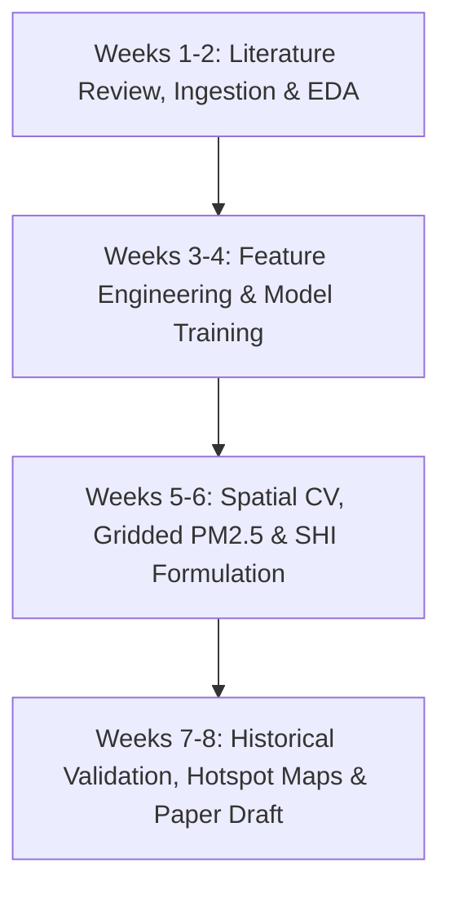

# 8-Week Internship Project Roadmap & Milestone Verification

**Project:** Machine Learning for Ground-Level $\text{PM}_{2.5}$ Estimation & Development of Smog Hazard Index ($\text{SHI}$)  
**Institution:** EHDS Lab / SUPARCO Projects  
**Target Areas:** Lahore, Gujranwala, Sheikhupura (Pilot Area) $\to$ Four-Province Expansion (Punjab, KP, Upper Sindh, ICT)

---

## Week-by-Week Implementation Plan

### Weeks 1–2: Dataset Ingestion, Quality Checks & Exploratory Data Analysis
- [x] Assemble matched satellite–meteorology–ground dataset across Lahore, Gujranwala, and Sheikhupura.
- [x] Ingest and clean ground observations from 12 monitoring stations across the 3 Excel workbooks.
- [x] Perform automated QA/QC: remove non-positive values, filter extreme sensor spikes using rolling median, apply EPA 75% daily completeness rules.
- [x] Generate EDA summary statistics, missing data profiles, and pollutant-meteorology correlation matrices.
- **Code Modules:** `src/data/ground_loader.py`, `src/data/satellite_loader.py`, `src/data/era5_loader.py`, `src/data/collocator.py`, `src/eda/eda_analysis.py`.
- **Scripts:** `scripts/01_process_ground_data.py`, `scripts/02_assemble_dataset.py`, `scripts/03_run_eda.py`.
- **Deliverables:** `outputs/eda/station_quality_report.csv`, `outputs/eda/correlation_heatmap.png`, `data/processed/matched_training_dataset.csv`.

---

### Weeks 3–4: Feature Engineering, Model Training & Spatial Cross-Validation
- [x] Engineer boundary-layer and meteorological stagnation features:
  - Ventilation Index ($\text{VI} = WS \times PBLH$)
  - Continuous Air Stagnation Index ($\text{ASI}$)
  - Atmospheric Column Extinction Ratio ($\text{AOD} / PBLH$)
  - Multi-pollutant ratio ($\text{NO}_2 / \text{SO}_2$)
  - Sinusoidal cyclical time encodings ($\sin/\cos\ \text{DOY}$, month, smog season flag)
  - Geospatial centroid distances
- [x] Train baseline and advanced machine learning estimators:
  - Linear Baseline (Ridge with standardization and imputation)
  - Random Forest Regressor
  - XGBoost Regressor
- [x] Set up Spatial Group K-Fold Cross-Validation and Leave-One-Station-Out (LOSO) CV to prevent spatial data leakage.
- **Code Modules:** `src/features/feature_engineering.py`, `src/models/linear_baseline.py`, `src/models/random_forest_model.py`, `src/models/xgboost_model.py`, `src/models/spatial_temporal_cv.py`.
- **Scripts:** `scripts/04_train_evaluate_models.py`.
- **Deliverables:** `outputs/models/*_final.joblib`, `outputs/evaluation/model_comparison_benchmark.csv`.

---

### Weeks 5–6: Model Evaluation, Gridded PM2.5 & Prototype SHI Formulation
- [x] Evaluate models on held-out stations using standard metrics ($R^2$, RMSE, MAE, MBE, IOA, FAC2).
- [x] Construct a 1 km regular spatial lattice covering Lahore, Gujranwala, and Sheikhupura.
- [x] Infer continuous ground-level $\text{PM}_{2.5}$ maps across the 10,962 grid cells using the best-trained model (XGBoost).
- [x] Formulate the prototype **Smog Hazard Index ($\text{SHI}$)** combining standardized $\text{PM}_{2.5}$, $\text{AOD}$, $\text{NO}_2$, $\text{SO}_2$, and meteorological stagnation.
- [x] Classify $\text{SHI}$ scores into standard hazard severity tiers: **Low, Moderate, High, Very High, Extreme**.
- **Code Modules:** `src/evaluation/metrics.py`, `src/evaluation/model_evaluator.py`, `src/spatial/grid_generator.py`, `src/spatial/spatial_predictor.py`, `src/index/shi_calculator.py`, `src/index/classifier.py`.
- **Scripts:** `scripts/05_generate_gridded_pm25.py`, `scripts/06_compute_shi_and_hotspots.py`.
- **Deliverables:** `outputs/gridded_pm25/gridded_pm25_map_20251115.png`, `outputs/shi_maps/shi_hazard_map_20251115.png`.

---

### Weeks 7–8: Historical Episode Validation, Hotspot Mapping & Documentation
- [x] Validate the $\text{SHI}$ against known historical Punjab smog episodes:
  - Episode A: Autumn Crop Burning Emergency (Nov 2025) $\to$ captures Extreme hazard
  - Episode B: Winter Radiation Fog-Smog Inversion (Dec 2025) $\to$ captures Very High hazard
  - Episode C: Clean Monsoon Baseline (Jul 2025) $\to$ captures Low/Moderate hazard
- [x] Detect acute spatial smog hotspots and generate district vulnerability summaries.
- [x] Refactor and integrate multi-station ARIMA time-series forecaster (`src/time_series/arima_forecaster.py`).
- [x] Document methodology note recommending four-province study rollout (`docs/methodology_note.md`).
- [x] Provide student satellite and reanalysis data acquisition manual (`docs/data_acquisition_guide.md`).
- [x] Prepare comprehensive `README.md` and master reproducible runner (`scripts/run_full_pipeline.py`).
- **Deliverables:** `outputs/reports/historical_episodes_validation.csv`, `outputs/shi_maps/smog_hotspots_map_20251115.png`, `docs/methodology_note.md`.
